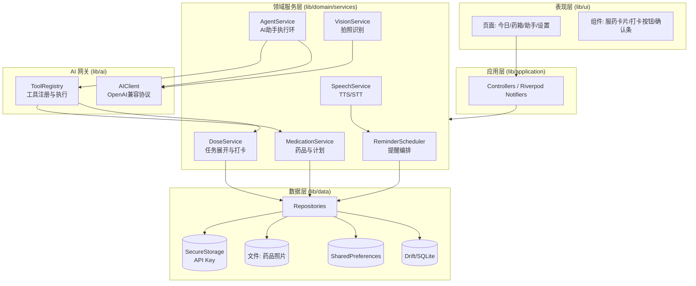
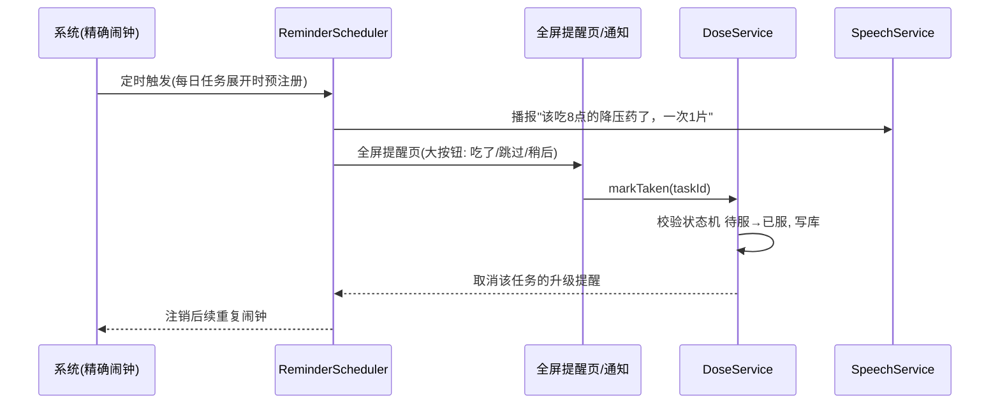
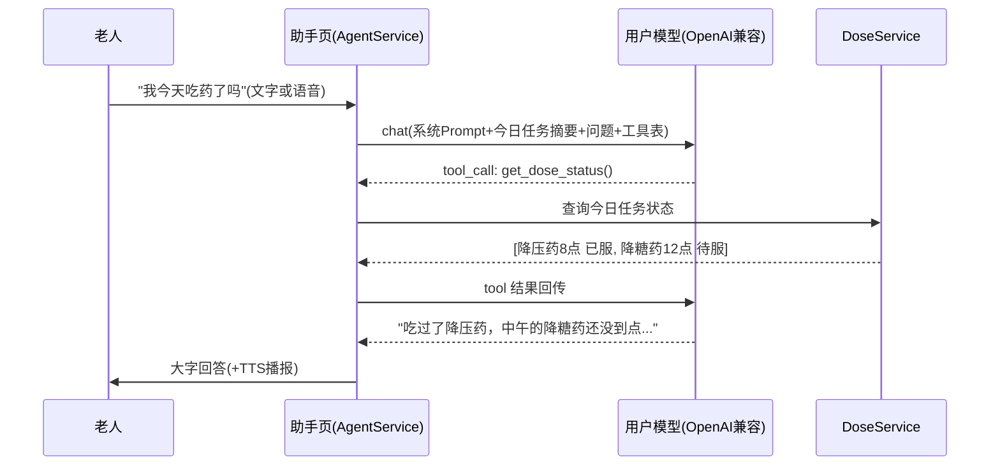

# 04 技术架构

## 1. 技术选型

| 领域 | 选型 | 理由 |
| --- | --- | --- |
| 框架 | Flutter（稳定版）+ Dart 3 | 需求既定；一套代码覆盖 Android/iOS |
| 状态管理 | Riverpod | 编译期安全、易测试、适合"服务+仓储"分层；不用 BuildContext 取依赖，后台提醒回调里也能拿到服务 |
| 本地数据库 | Drift（SQLite） | 关系型数据（药/计划/记录）+ 强类型 + 自带迁移；比 NoSQL 更适合本项目的查询（按日期展开任务、统计） |
| 路由 | go_router | 声明式路由，深链（点通知跳"今日打卡页"）方便 |
| 网络 | dio | AI 请求（SSE 流式可后续扩展）；超时/重试策略集中管理 |
| JSON 模型 | freezed + json_serializable | 草稿/工具参数等嵌套结构多，不可变模型省心 |
| 通知/闹钟 | flutter_local_notifications + timezone | zonedSchedule 精确闹钟；全屏意图；重启恢复 |
| TTS / STT | flutter_tts / speech_to_text | 系统能力，离线性取决于系统服务和语言包（见 03 §9） |
| 相册相机 | image_picker | 拍照识别入口 |
| 条码扫描 | mobile_scanner（Android bundled ML Kit / iOS 系统能力） | 本地解码，openFDA 按商品条码查询，详见 [11](11-药品条码查询.md) |
| 图片处理 | image 包（压缩、EXIF 方向） | 上传前压缩，省 token 与流量 |
| 密钥存储 | flutter_secure_storage | API Key（见 03 §10） |
| KV 设置 | shared_preferences | 非敏感设置项（字体档位、开关） |
| 日志 | logger + 环境开关 | AI 请求日志默认脱敏关闭 |

**原则：能用系统能力就不引第三方云服务**（TTS、STT、通知均如此），与"本地优先、无账号"的产品原则一致。

## 2. 分层架构



要点：

- **领域服务是唯一业务逻辑所在**，UI 与 AI 工具都调用同一套服务（AI 打卡和手指打卡走完全相同的 `DoseService`，保证规则一致）。
- **ReminderScheduler 不做业务判断**：它只负责"把 DoseService 展开出的任务按时通知出去"，判断逻辑（漏服、状态机）都在 DoseService。
- **AIClient 与业务零耦合**：只认 OpenAI 协议；配置由调用方传入。

## 3. 目录结构规划

```
lib/
├── main.dart
├── app.dart                 # MaterialApp、主题、路由表
├── core/                    # 通用：常量、异常、扩展、格式化(时间口语化)、日志
├── ai/
│   ├── client/              # OpenAI 兼容 HTTP 客户端(含 SSE 预留)
│   ├── prompts/             # 系统 Prompt 常量、识别抽取 Prompt、JSON schema
│   ├── tools/               # 工具定义(JSON Schema)与本地执行器、规则意图
│   └── (fixtures 见 test/，假响应回归)
├── data/
│   ├── db/                  # Drift 表定义、迁移（仓库接口+实现见 repositories/）
│   ├── repositories/        # 仓库：抽象接口 + Drift 实现（服务与测试都面向接口）
│   ├── settings/            # KV 抽象(SharedPreferences/内存)、设置服务
│   └── backup/              # 数据导出/导入（docs/05 §4）
├── domain/
│   ├── models/              # freezed 实体(Medication, DoseTask, ...) + 视图模型
│   └── services/            # 见架构图（DoseService/MedicationService/
│                            #   ReminderScheduler/AgentService/VisionService/
│                            #   ModelSelectionService + SpeechService 接口）
├── application/             # Riverpod providers & controllers
├── platform/                # 系统插件适配：通知网关(flutter_local_notifications)、
│                            #   TTS/STT 系统实现、secure storage 适配、设备通道、
│                            #   图片压缩（domain 接口的系统实现都收拢在此）
├── ui/
│   ├── theme/               # 适老化主题(字号档位、对比色)
│   ├── shell/  today/  cabinet/  assistant/  settings/  onboarding/
│   └── widgets/             # 通用组件(大按钮/确认条/空态/免责脚注)
├── background/              # (预留) 通知点击/后台回调入口 —— 当前入口转发在
│                            #   application/router.dart + platform 网关回调
tools/check_layering.dart    # 分层依赖检查脚本（docs/04 §7，CI 强制）
```

## 4. 关键流程时序

### 4.1 到点提醒 → 打卡



### 4.2 AI 问答"今天吃没吃药"



### 4.3 拍照添加药品

拍照 → 压缩 → VisionService 调视觉模型（03 §6 的 JSON 契约）→ 解析校验 → **草稿确认页**（字段逐项可改）→ 用户确认 → MedicationService 建卡 + 预填计划 → 提示"要不要顺便设提醒"。

## 5. 提醒技术要点（详见 06 文档）

- Android 12+ 申请 `SCHEDULE_EXACT_ALARM`；通知用 `fullScreenIntent` + 自定义铃声；`RECEIVE_BOOT_COMPLETED` 重启后由 DoseService 重新展开并注册全天任务。
- 任务展开策略：**每日一次展开未来 7 天任务并注册闹钟**（而非一次性注册全部），兼顾隔天/星期频率与厂商 ROM 对 alarm 数量的限制。
- 厂商 ROM（小米/华为/OPPO/vivo）引导页：检测厂商 → 引导加白名单，首次启动与设置页各一个入口。

## 6. 测试策略

- **领域层单测为主**：DoseService 状态机、任务展开（跨日/隔天/星期）、漏服判定、Agent 工具执行——全部纯 Dart 可测，是回归安全网。
- AI 交互用**录制的假响应**（fixture JSON）测解析与降级链，不做真实网络单测。
- Widget 测试覆盖关键页面（今日页打卡、草稿确认页）。
- 真机矩阵测试（见 08 里程碑 M3）：至少覆盖一台国产 ROM + 一台原生 Android。

## 7. 分层依赖规则（防止架构腐化）

分层的价值不在目录好看，而在**依赖方向可约束**。以下规则从第一行代码起生效，违反即评审打回：

| 规则 | 理由 |
| --- | --- |
| 依赖单向：`ui → application → domain(services) → data(repositories)` | 反向依赖（如 service 里 import 页面）是腐化起点 |
| **UI 禁止直接触碰 DB / Repository** | 打卡、状态判定等逻辑必须只有一份（AI 工具和手指点击走同一个 `DoseService`），UI 直查 DB 必然造成双份逻辑漂移 |
| **domain 层纯 Dart**：services/models 不 import `flutter/material` | 保证任务展开、状态机、漏服判定能被纯 Dart 单测秒级覆盖，不用起 Widget 测试 |
| `ai/` 与 domain 平级、只被调用不调用 UI | AIClient 不知道"药品"存在，只知道 OpenAI 协议 |
| `background/` 只做入口转发 | 通知回调里只调用 service 方法，不写业务，避免后台路径与前台路径行为不一致 |

**强制手段**（不靠自觉）：

- `analysis_options.yaml`：`flutter_lints` 基础上追加严格项（`avoid_dynamic_calls`、`unawaited_futures` 等）；
- CI 中用轻量脚本检查 import 方向（按目录前缀 grep 即可，不必引重型工具）；
- 命名约定：文件 snake_case；service 方法动词开头（`expandTasks`、`markTaken`）；业务常量集中在 `core/constants`，Prompt 只存在于 `ai/prompts/`——**禁止 Prompt 字符串散落在业务代码里**（Prompt 是最常迭代的东西，必须一处可改）。

## 8. 依赖注入与可替换性

Riverpod provider 分三层，替换和测试都靠 override，**不写任何 `if (测试环境)` 分支**：

| 层 | 示例 | 生命周期 |
| --- | --- | --- |
| 基础设施 | `dbProvider`、`secureStorageProvider`、`dioProvider`、`notificationPluginProvider` | App 级单例 |
| 领域服务 | `doseServiceProvider`、`reminderSchedulerProvider`、`agentServiceProvider` | 依赖基础设施层 |
| 控制器 | 各页面的 Notifier | 随页面 |

**面向接口的关键抽象**（为了"将来能换"）：

- `AiChatClient` / `AiVisionClient` 抽象类，当前只有 OpenAI 兼容实现。未来接入非兼容协议时新增实现类即可，`AgentService` 与所有业务零改动；
- `SpeechService` 抽象 TTS/STT，系统引擎为默认实现，云端方案将来作为另一个实现插入；
- 所有服务在 Widget/单元测试中用 `ProviderContainer(overrides: [...])` 注入 fake 实现。

## 9. 扩展指南（常见变更 Playbook）

改代码前先查本节：每个 playbook = 步骤 + 必须同步的文档/测试。**新功能需求先在这里找 nearest playbook，找不到再新增本节条目**。

### 9.1 新增一个 AI 工具

1. 对应 domain service 补业务方法 + 单测（工具只是薄封装）；
2. `ai/tools/` 注册 JSON Schema 与本地执行器；**写类工具**必须接入"可撤销确认条"机制（03 §4）；
3. 同步更新系统 Prompt 中的工具清单与降级 JSON 协议描述（`ai/prompts/`）；
4. `ai/fixtures/` 加一条假响应，纳入回归测试；
5. 更新 `docs/03` §4 工具表。

### 9.2 新增一种用药频率

1. models 枚举 + schedule 字段扩展；2. `DoseService.expandTasks` 实现展开规则，**必须含跨日/月末边界单测**；3. Drift 迁移（schemaVersion+1，见 §12）；4. 加药表单加对应模板选项；5. 更新 `docs/05`。

### 9.3 接入非 OpenAI 兼容的模型协议

实现 `AiChatClient` 新实现类 → 模型配置增加"协议类型"字段 → 配置页加表单项 → 更新 `docs/03` §2。业务层与工具层不动。

### 9.4 新增设置项

非敏感项走 `app_settings` KV（默认值集中在 settings service，禁止散落默认值）；敏感项（密钥类）走 secure storage。若影响老人日常使用，先过一遍 07 §3 适老化规范。

### 9.5 新增页面 / Tab

go_router 路由 + controller + 页面三件套；入口层级必须符合 07 §1 的四 Tab 信息架构——**新增顶级入口需按 01 §5 产品原则裁决**（默认答案是塞进现有 Tab）。

## 10. 错误处理与可观测性

自己给父母装的 App，**必须能远程排查问题**（而老人只会说"它不好使了"）。

- **统一异常层次**：`sealed class AppException`（`NetworkException` / `AiException` / `DatabaseException` / `ValidationException`），领域层只抛类型化异常，不带 UI 文案；
- **翻译原则**：UI 层是唯一把异常翻译成 07 §5 口语文案的地方（"网络不太好，过会儿再问我"），任何堆栈/错误码不得直达老人；
- **三类必留痕**（出问题能回放）：AI 请求与响应（API Key 脱敏）、通知的调度与触发事件、数据库迁移步骤；
- **日志**：分级（debug 构建才 verbose），滚动写入本地文件，设置页提供"导出日志"（分享文件给子女，远程定位）；
- **崩溃捕获**：`FlutterError.onError` + `PlatformDispatcher.instance.onError` 写入本地日志，随日志一起导出；不接任何第三方崩溃 SDK（隐私承诺，04 §14）。

启动先读取本地偏好与语言并显示 Flutter 首帧。`AppPlatformStartup` 在首帧后独立执行
通知初始化、通知冷启动意图读取和 Android WorkManager 注册；每项最多等待 10 秒，
异常记录日志，不能阻塞页面或其他启动任务。超时或已释放后的通知意图结果不再跳转。
main 注入的通知网关由所有前台提醒共用，初始化并发共享一个 Future，失败/超时后可重试。
启动补偿仍异步执行，通知操作先确保网关初始化完成。

## 11. 版本、升级兼容与发布

- **版本管理**：应用版本 semver；**Drift schemaVersion 独立递增**，每次改表必须：写迁移 step + 写 `fromSchema(N)` 迁移测试，缺一不合入；
- **数据向前兼容**：导出 JSON 带 `schemaVersion`；**新版本必须能导入旧备份**（这是用户唯一的数据逃生通道），旧版本不承诺读新格式；
- **升级红线**：任何版本发布前，必须真机验证"覆盖安装升级后：历史打卡记录还在、下一个提醒到点还响"——升级弄丢提醒是比崩溃更严重的事故；
- **发布 checklist**：`flutter analyze` + `flutter test` 绿 → `flutter build` → 真机冒烟（全新安装 + 覆盖升级两条路径 + 06 的"提醒测试"入口）→ 更新 `CHANGELOG.md` → 打 tag；
- **Release 资源检查**：构建后运行 `dart run tools/check_release_resources.dart`，直接检查最终 APK 中 `drawable/ic_notification` 与 `raw/alert_long` 的文件资源。Dart 中的资源名无法被 Android 压缩器静态追踪，必须通过 `res/raw/keep.xml` 保留；不能只检查源码或合并前资源。安装 Release 后先强制停止再冷启动，确认原生开屏退出、通知图标与铃声正常、通知点击可回到提醒页；
- **feature flag**：未完成功能用简单 KV 开关隐藏入口（不做半成品 UI 上线），上线稳定后删除开关代码，不留死代码。

## 12. 文档同步约定（docs as code）

**`docs/` 是唯一事实来源**。代码与文档冲突 = 必有一错，修代码的同一个 PR 里修文档，映射关系：

| 改了什么 | 必须同步 |
| --- | --- |
| AI 工具 / Prompt 策略 / 模型接入 | `docs/03` |
| 表结构 / 状态机 | `docs/05` |
| 提醒行为 | `docs/06` |
| 功能增删 / 优先级 | `docs/02`、`docs/08` |
| 分层 / 选型 / 依赖规则 | `docs/04`（本文档） |

**重大决策记录（轻量 ADR）**：改选型、否决某方案时，在 `docs/adr/ADR-NNN-标题.md` 写一页纸：背景 → 决策 → 被否决的备选及原因 → 后果。目的是**半年后不重翻案**（例：为什么选 Drift 不选 Isar、为什么 TTS 用系统引擎不用云端）。模板：

```markdown
# ADR-NNN: <决策标题>
日期 / 状态(已采纳|已废弃)
## 背景    当时面对的问题与约束
## 决策    选择了什么
## 备选与否决原因  至少一个"为什么不选它"
## 后果    带来的好处、代价、后续触发重新评估的条件
```

## 13. 技术债登记与演进预留

每个里程碑收尾时清点一次技术债，登记在本节并标注偿还时机；带着隐性债务进下一个里程碑是最高风险项。

| 已知债务/预留 | 说明 | 偿还时机 |
| --- | --- | --- |
| 单包结构 | 当前规模不拆 package；当 `ai/` 或 `domain/` 需被第二个 App（如家属端）复用时，再抽 Dart package | 出现第二个消费方时 |
| SSE 流式输出 | `AiChatClient` 接口已预留，M1 先整段返回 | M2 |
| 多老人档案 | 数据模型用 uuid 主键、无用户耦合字段，未来加 `profile_id` 一次性迁移即可 | 有真实需求时 |
| 数据库端到端加密 | 04 §14 列为远期评估 | 涉及敏感健康数据合规评估后 |
| 提醒的 WorkManager 备选通道 | 若厂商 ROM 对精确闹钟限制超预期，评估 `workmanager` 作为补充触发源 | M3 真机矩阵测试后视情决定 |

## 14. 明确不做的事

- 不引入 Firebase / 任何分析 SDK（隐私承诺）。
- 不做自建后端（v1 无此需求）。
- 不做数据库端到端加密（v1 用系统沙箱 + 全盘加密即可，列为远期评估项）。

## 14. Agent v2 实现边界

应用层 `AssistantController` 接收轮次进度和已提交操作，`VoiceController` 持有按住手势与音频生命周期；UI 仅负责事件、可见性和渲染。领域层 `ConversationContext` 管理预算、`MemoryService` 管理显式记忆、`AgentService` 协调摘要、取消、工具与持久轮次。数据层 `AgentStore` 与业务仓库共用 Drift 事务。平台层语音引擎以接口注入，可测试回调交错。

客户端通过 CancellationSignal 取消 Dio；区分鉴权、限流、上下文超限、明确工具不支持和其他网络/协议错误。上下文超限只重新裁剪一次，不重放写入。失败轮次和“操作成功但续答失败”是显式结果。

schema 2 与备份 2 契约见 05，最终合并 Manifest 检查见 `tools/check_agent_manifest.dart`，环境及验收限制见 10。模拟引擎测试不能代替实际录音/声音播放验收。
