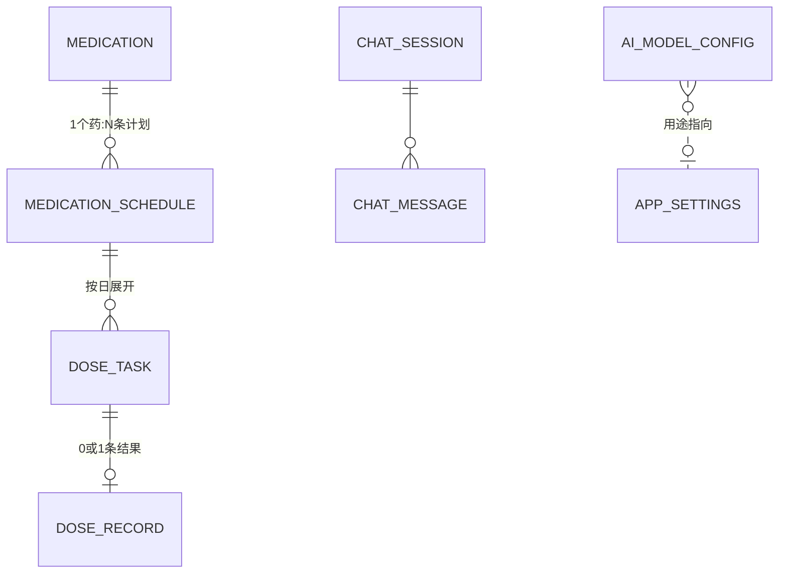

# 05 数据模型设计

## 1. 实体关系总览



核心设计决策：**把"计划（重复规则）"和"当天任务（某天某次的实例）"分开**。

- `MEDICATION_SCHEDULE` 存重复规则（每天 8 点），永久不变更；
- 每天由 DoseService 把未来 7 天的规则**展开**成 `DOSE_TASK`（2026-09-28 08:00 降压药 1 片）；
- 打卡、漏服判定、统计、AI 查询全部只碰 `DOSE_TASK`，不再解析规则。
- 好处：规则改动不影响历史记录；隔天药/星期药展开一次搞定；"补记昨天的"就是改昨天那条 task。

## 2. 表结构

### medications（药品）

| 字段 | 类型 | 说明 |
| --- | --- | --- |
| id | text PK (uuid) | |
| name | text | 用户可读名，如"苯磺酸氨氯地平片"或子女填的"降压药" |
| form | text | 剂型枚举：tablet/capsule/liquid/patch/spray/injection/other |
| spec | text? | 规格，如 "5mg×30片" |
| dose_unit | text | 打卡剂量单位：片/粒/毫升/喷/支 |
| notes | text? | 备注（医嘱原文） |
| photo_path | text? | 药盒照片（本地文件） |
| source | text | manual / ai_photo / barcode（AI 与条码录入保留溯源，条码资料来源另记在备注） |
| ai_extract_json | text? | AI 识别原始输出（纠错与回溯用） |
| status | text | active / archived（停用不物理删） |
| created_at / updated_at | int (epoch ms) | |

### medication_schedules（用药计划）

| 字段 | 类型 | 说明 |
| --- | --- | --- |
| id | text PK | |
| medication_id | text FK | |
| frequency_type | text | daily / weekdays / interval_days / as_needed |
| weekdays | text? | frequency_type=weekdays 时用，如 "1,3,5"（周一=1） |
| interval_days | int? | 隔 N 天，配 `anchor_date` 计算基准 |
| anchor_date | text? | 间隔计算的锚点（ISO 日期） |
| times_json | text | 时刻数组 `[{"time":"08:00","dose":1.0,"meal":"after"}]`（as_needed 为空） |
| meal_relation | text? | before/with/after（冗余到时刻级，此处存计划级默认值） |
| start_date | text | 生效起始日 |
| end_date | text? | 疗程结束（可空=长期） |
| status | text | active / paused |
| created_at | int | |

> ~~备选简化方案：每个时刻单独一条 schedule（一行一个时间点）。展开逻辑更笨但更简单，统计口径不变。实现时二选一，DAO 层封装住差异即可。~~
> **已拍板：单计划多时刻**（docs/09 Q2 的推荐项），决策与理由见 `docs/adr/ADR-001-计划建模-单计划多时刻.md`。

### dose_tasks（服药任务，按日展开的实例）

| 字段 | 类型 | 说明 |
| --- | --- | --- |
| id | text PK | |
| schedule_id | text FK | 溯源到计划 |
| medication_id | text FK | 冗余，加速查询 |
| scheduled_date | text (ISO) | 应服日期 |
| scheduled_time | text (HH:mm) | 应服时刻 |
| planned_dose | real | 应服剂量 |
| status | text | pending / taken / skipped / missed（见状态机） |
| taken_at | int? | 实际打卡时间 |
| mark_source | text? | tap / notification / voice / ai / catch_up（补记标记） |
| note | text? | 备注（AI 代办时模型带回来的"刚才吃的"之类） |

索引：`(scheduled_date, scheduled_time)`（今日页与提醒展开主查询）、`(medication_id, scheduled_date)`。

**状态机**：

```
pending ──打卡──▶ taken（可撤销回 pending）
pending ──跳过──▶ skipped（可撤销回 pending）
pending ──超过宽限期仍未确认──▶ missed（仍可补记为 taken，mark_source=catch_up）
```

宽限期默认 60 分钟（可配），由每日任务展开时的后台检查 + 打开 App 时补偿检查共同推进（不强依赖后台进程，见 06 文档）。

### chat_sessions / chat_messages（AI 对话）

| 字段（chat_messages） | 类型 | 说明 |
| --- | --- | --- |
| id | text PK | |
| session_id | text FK | v1 单会话即可，保留 session 便于"新对话" |
| role | text | user / assistant / tool |
| content | text | 文本内容 |
| tool_name / tool_payload | text? | 工具调用留痕（调试与"AI 帮我打卡了什么"可回溯） |
| created_at | int | |
| sequence | int | v2 稳定递增消息顺序，不以时间戳或 UUID 排序 |

### ai_model_configs（模型配置）

见 03 文档 §2 字段表。`api_key` 不入 Drift，以 `config.id` 为键存 `flutter_secure_storage`。

### medication_drafts（识别/对话产生的草稿）

| 字段 | 类型 | 说明 |
| --- | --- | --- |
| id | text PK | |
| source | text | photo / chat |
| payload_json | text | 结构化草稿全量 JSON |
| photo_path | text? | |
| status | text | pending / confirmed / discarded |
| created_at | int | |

### app_settings（KV，存 SharedPreferences 即可，不建表）

字体档位、TTS 开关/语速、提醒提前量、升级提醒配置、宽限期分钟数、当前对话/视觉模型 id、引导完成标记。

## 3. 数据示例

**"降压药，每天早 8 点晚 8 点各 1 片，餐后"** 展开为：

```
medications:  { name: "降压药", form: tablet, dose_unit: "片" }
schedules:    { frequency_type: daily, times_json: [
                 {"time":"08:00","dose":1,"meal":"after"},
                 {"time":"20:00","dose":1,"meal":"after"} ] }
dose_tasks:   2026-09-28 08:00 降压药×1 → taken(08:05 打卡)
              2026-09-28 20:00 降压药×1 → pending
              2026-09-29 ... (每日展开)
```

**"钙片，隔一天吃一次"**：`frequency_type=interval_days, interval_days=2, anchor_date=2026-09-28` → 28、30、10-2… 展开。

## 4. Agent v2 数据与迁移

Drift schema 为 **2**。迁移在原数据库上新增 `chat_messages.sequence`、`ai_model_configs.context_window_tokens`（默认 8192）及 `agent_records`，保留药品、计划、打卡、旧聊天和模型配置。旧消息按 `created_at, rowid` 回填序号，同时间戳保持原插入顺序。新消息在事务中分配下一序号，重复 ID 不插入。

`agent_records(id PRIMARY KEY, kind, payload JSON)` 保存以下记录，由 `AgentStore` 统一访问：

| kind / key | 内容 |
| --- | --- |
| context / `context` | generation、恢复边界 cutoff、摘要 covered/summary、memoryRevision、撤回来源 suppressed、业务数据版本 dataRevision |
| turn / `turn:<id>` | text、sequence、generation、running/completed/failed/cancelled、完整协议 messages、reply |
| memory / `memory:<id>` | id、content、source=user_reported、sourceMessageId/sourceText、createdAt/updatedAt |
| operation / `op:<turn>:<tool>:<target>` | 原始及规范化参数、已提交结果、目标、before/after 快照、undone、dataRevision |

业务写入和操作收据共用 Drift 事务。重新打开应用可从 running/failed/cancelled 轮次重试，从收据恢复撤销及草稿入口；草稿必须经过确认页。撤销按快照比较检测冲突。旧版 user/assistant 聊天仍可读取；新历史回放完整工具往返，整轮保留或移出。

清空聊天与长期记忆独立；清空递增 generation，删除聊天/轮次/摘要，保留记忆及已提交业务记录。失败或取消请求不能回写旧 generation。

## 5. 备份 v2

备份版本与 Drift 版本独立，JSON 字段为 `schema_version`。v2 增加 `memories` 及模型 `contextWindowTokens`；默认不导出 API Key，原始聊天、摘要和操作收据不导出。显式记忆保留用户自述来源文本，但清除绑定本机消息的 sourceMessageId。

新版接收 v1/v2：v1 不含 memories，保留本机记忆；v2 按覆盖恢复语义替换记忆。导入前校验结构、ID、引用、记忆字段及模型窗口；失败恢复业务数据、设置、密钥与记忆快照。同 ID 配置且备份未带密钥时保留本机密钥。

恢复后递增会话版本和业务数据版本，以最新聊天序号设置 cutoff，清空摘要；旧聊天仍可查看，但旧工具 ID、摘要与旧撤销收据不再参与恢复后的业务上下文。UI 重新加载提醒。真实 SQLite 迁移/回滚测试见 `test/agent_storage_test.dart`。
