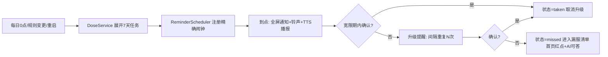

# 06 提醒与通知设计

> 提醒是这个产品的生命线——漏提醒一次，老人就漏吃一次药，产品信任归零。本文档定义完整提醒链路与Android 各厂商 ROM 的存活策略。

## 1. 提醒链路总览

触发源有四个（缺一不可，互为补偿）。**v1 实现口径**如下（`ReminderScheduler`）：

1. **每日展开**：设计为每天 0 点后闹钟触发；v1 落地为**每次打开 App / 规则变更时展开未来 7 天并一次性注册全部闹钟**——7 天预注册覆盖用户数日不打开 App 的情况；每日 0 点的后台闹钟依赖 `workmanager` 类常驻通道，已列 docs/04 §13 技术债按需评估；
2. **规则变更**：新增/修改/暂停计划、打卡/撤销后 `syncUpcoming()` 全量重排（先 cancelAll 再注册）；
3. **重启补偿**：`RECEIVE_BOOT_COMPLETED` 由 flutter_local_notifications 的 BootReceiver 恢复已排程闹钟；插件级恢复失败时由下一次启动补偿兜底；
4. **App 启动补偿**（`onAppStart`）：打开 App 时展开任务 + 补漏服判定 + 重排提醒。**这条保证即使所有后台手段都被 ROM 杀掉，只要老人打开过 App，状态就不会错**。

实现注意：

- 同一分钟的多任务合并为一条提醒（payload 携带全部 taskIds，深链进全屏提醒页逐项打卡）；
- 主提醒 ID / 升级提醒 ID 由 `stableHash("main|date time")` 等确定性派生，保证打卡后可精确取消；
- 升级提醒只对未来 48h 内的任务注册，更远的由后续每日重排续上；
- 渠道使用自定义长铃声 `res/raw/alert_long.wav`（约 14 秒钟声）+ `AudioAttributesUsage.alarm`（媒体静音也能响）+ `fullScreenIntent`；
- 精确闹钟被拒时自动退化 `inexactAllowWhileIdle`。

通知资源 `drawable/ic_notification` 与 `raw/alert_long` 在 `res/raw/keep.xml` 中显式保留，
避免 Release 资源压缩把 Dart 按名查询的图标和铃声删除。CI 使用
`tools/check_release_resources.dart` 检查最终 APK 的资源名及文件条目。
通知初始化放在 Flutter 首帧之后，失败或超时不阻塞前台；所有前台调用共用一个网关，
并发初始化共享同一操作，失败后下次调用可重试。权限在首次引导/设置测试入口申请，
iOS 初始化阶段不弹权限框。冷启动意图读取独立于初始化，首帧后进入提醒页，
超时或 App 已释放后的结果不再导航。

## 2. 到点呈现

| 层 | 内容 |
| --- | --- |
| 系统通知 | 高优先级渠道、横幅+铃声+震动、`fullScreenIntent`（锁屏/息屏直接弹全屏提醒页） |
| 全屏提醒页 | 超大字："该吃药了"；药名+剂量+餐前餐后；三个大按钮：**吃了 / 等会儿再提醒 / 今天不吃了** |
| 语音播报 | TTS 循环播报 2 遍："8 点了，该吃降压药了，一次 1 片。"（设置可关） |
| 通知操作按钮 | v1：点通知深链进全屏提醒页，超大"吃了"一键打卡（两次点击）；通知栏直达打卡按钮依赖后台 isolate 写库，列为 M2/M3 增强（需 `onDidReceiveBackgroundNotificationResponse` + 后台初始化链路） |

铃声使用自定义长铃声（老人对默认"滴"声不敏感），音量走闹钟通道（`ALARM`/音频属性 alarm），避免媒体静音时听不到。

## 3. 升级提醒与漏服判定

- **宽限期**：默认 60 分钟内可正常打卡（状态 taken）；
- **升级提醒**：默认到点后 15 分钟再响，共 3 次（间隔与次数可配；App 内也做醒目的红点+首页顶部横条，不只依赖通知）；
- **漏服判定**：宽限期结束仍无确认 → `missed`。判定由"每日补偿检查 + App 启动补偿"执行，不要求 App 活着；
- **补记**：missed 后当天补记（`mark_source=catch_up`），统计上区分"按点吃"与"补吃"，AI 回答"我今天吃药了吗"时如实说明："降压药是 9 点半补吃的，按时吃的是…"。

## 4. Android 权限与保活（工作量重灾区，重点排期）

| 项 | 要求 | 策略 |
| --- | --- | --- |
| 通知权限 | Android 13+ 运行时申请 | 引导页一步申请，拒绝后用醒目横幅引导去设置 |
| 精确闹钟 | Android 12+ `SCHEDULE_EXACT_ALARM` / 14+ 需用户授权 | 启动引导检查，跳系统授权页；不可用时退化 `inexact` 并提示 |
| 电池优化 | 加入忽略名单 | 引导跳系统弹窗（`ACTION_REQUEST_IGNORE_BATTERY_OPTIMIZATIONS`） |
| 厂商 ROM | 小米/华为/荣耀/OPPO/vivo 各有自启动、省电策略 | 检测 `Build.MANUFACTURER` → 展示对应图文引导页（自启动+锁后台+通知三类开关）；首次启动和设置页都有入口 |
| 全屏意图 | Android 14+ 需用户在设置里授予 | 引导页带"去授权"直达 |

**产品兜底**：在"提醒测试"入口（设置页），让子女配置完当场验证"到点真的会响"，避免配置完了才发现被 ROM 拦截。

## 5. iOS 要点

- 本地通知 `UNCalendarNotificationTrigger` 精确到分钟，足够可靠（iOS 无 ROM 杀后台问题）；
- 通知权限申请文案要写清楚价值；
- TTS 播报在前台进行；后台播报受限于系统（锁屏后不播），产品上接受"通知铃声 + 进 App 播报"的体验，不做后台音频保活（ violates App Store 审核风险）。

## 6. 边界情况清单

| 情况 | 处理 |
| --- | --- |
| 跨时区/出差 | 任务存"本地墙钟时间"，timezone 包处理 DST；跨时区按当前时区时间触发 |
| 设备日期被老人误改 | 以设备时间为准（无网兜底），启动检测时间跳变提示 |
| 深夜提醒 | 按需药（as_needed）默认静默时段 22:00–7:00 不闹铃只留通知；慢病固定药不受静默（吃药比睡觉重要，且可自行调时间） |
| 通知点击 | 深链到全屏提醒页（有 pending 任务）或今日页 |
| 提醒风暴（多药同时刻） | 同一分钟多任务合并为一次提醒，页内列出全部待服药 |

## 7. 助手与提醒的音频协调

系统 TTS 以完成/失败/取消事件结束，不固定等待 6 秒。提醒第一遍确实完成后再播第二遍；失败或取消不续播。提醒抢占助手录音与播报，停止助手音频只作用于助手 owner，不能停止提醒。助手页隐藏/后台后不自动播放迟到模型回复；网络保存与音频生命周期独立。

Agent 打卡事务提交后立即显示操作条并刷新今日页，再同步提醒；同步失败明确提示，业务成功和撤销入口仍保留。清空聊天不撤销打卡。恢复备份创建新业务上下文边界，不能使用旧操作收据覆盖恢复后的数据。

Android Release 主清单含 INTERNET、RECORD_AUDIO、ASR/TTS 服务查询及蓝牙权限；CI 构建 Release 并检查合并清单。系统语音是否可用、是否离线取决于设备服务和语言包，铃声/文字入口仍可用。真机矩阵见 10 文档。
